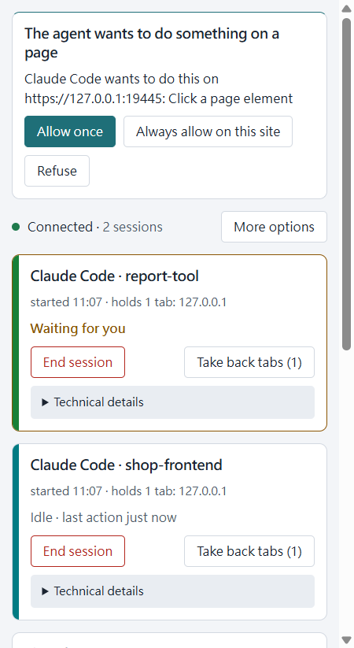

# Changelog

What each Hallpass release changed, newest first. Every release is on the
[releases page](https://github.com/norton77930/hallpass/releases) with its zip. Upgrading is
the same every time unless a section says otherwise: reinstall the host (`install.ps1` from the
zip, or `npm run agent-host:install` from source) and reload the extension.

## 0.16.1 — 2026-10-26

**Clearer answers when an agent is slow or out of quota.**

- **Slow `--version`.** An agent found on the machine whose `--version` does not answer within the
  check's time (Hermes can take several seconds) is now described as such on its card, not as
  "did not report a version number". Hallpass asks it once more in the background, and the card turns
  Ready when it answers.
- **The agent's own words on failure.** When an agent's turn or the settings page's Test fails, the
  side panel and the card show what the agent said (for example Codex's usage-limit message and when it
  lifts) instead of a bare "Internal error".
- **Stopping a background check** now also ends its Windows environment query at once.

## 0.16.0 — 2026-10-25

**A settings page for agents, sites and the connection; the side panel keeps to what is happening now.**

- **Settings page.** A full tab (side panel menu, or the extension's Options) with four sections: Agents,
  Sites & permissions, Browser tools, and Connection & diagnostics. It works without network, in English
  and zh-TW, light or dark, and down to a 375 px wide window.
- **Agents at a glance.** Each agent is a card with one of five states (ready, ready with warnings, needs a
  download, downloading, not installed), its version, prerequisites, model server and browser tools, all
  from local checks. The navigation says how many are ready.
- **Prepare an agent from its card.** Hallpass's helper downloads run there with progress and Cancel, and
  keep going when the page is closed; Hermes shows its setup steps and Check again.
- **Test an agent.** One short model call that says whether the agent starts, answers and gets the browser
  tools, in the owner's words, with the last result kept.
- **Choose the panel's agents.** An Enabled switch per agent and Make default decide what the side panel's
  picker offers, per browser.
- **Sites & permissions moved here.** Paired outside agents, each site's mode, the diagnostics grant, who
  made the last change, Revoke with Undo, and the upload folders. A session card links straight to its site.
- **Connection & diagnostics.** Whether the helper is connected, the versions, this browser's name with
  Rename, and each agent's last lines of output on request, with secrets removed.
- **The side panel has two tabs, Conversation and Sessions.** Sessions shows the connection and the live
  sessions; standing permissions are managed on the settings page.
- No API key is asked for, shown or stored; key variables are named only.

## 0.15.2 — 2026-10-24

**Fixes from the first real Hermes trial: saved logins really off, clear waiting feedback, and the tab for every agent.**

- **Hermes never gets the saved-logins tool.** 0.15.0 and 0.15.1 switched it off under a name Hermes does
  not use, so the tool was still in Hermes' look-up catalog. It is now off in both modes; Hermes' own
  browser tools go with it (Hallpass's browser tools are the ones it uses).
- **The panel says what it is waiting for.** While an agent starts: "Starting <agent>… (the first start can
  take 30–60 s)". While a message waits for the model: the seconds waited, and after 30 s a hint to check
  that the model server is reachable (network or VPN). Before, the panel could show nothing for minutes.
- **Missing browser tools are explained.** When Hermes runs without its optional MCP component, or with
  DeepSeek (which has no MCP support), the panel says the agent cannot use the browser and what to do:
  install Hermes' MCP component, or attach a screenshot or the tab.
- **"Attach this tab" works with Hermes and DeepSeek.** For an agent that does not take page context, the
  tab's title and text are saved as a `.txt` file in the conversation folder and named by path.
- **A key the browser cannot see is explained.** When an agent fails to start and the key variable its own
  settings name is set for your user but missing from what Chrome passed on (Chrome was started before you
  set it), the panel says to quit Chrome completely, including background mode, and reopen it. Hallpass
  checks the name only, never the value.
- **The agent's own output on request.** Conversation details can show the agent's last lines of output,
  with environment values removed; kept in memory only and dropped with the conversation.
- **Agent installs are sturdier**: an interrupted install by a process that has since ended is picked up
  again, and a file held by another program is no longer taken for a damaged install.
## 0.15.1 — 2026-10-23

**DeepSeek's first download is several times faster, and dependency security fixes.**

- **Faster first install.** An agent Hallpass downloads (DeepSeek, and the Claude and Codex adapters) is
  now used where it was downloaded instead of being moved into place afterwards. On a machine with a
  real-time file scanner, that move alone took about 41 minutes for DeepSeek; the first DeepSeek
  download now took 5.5 minutes there. Installs made by earlier versions keep working without a new
  download.
- **Dependency updates** for reported vulnerabilities: the MCP SDK 1.32.0 (with hono 4.13.11 and
  ip-address 10.7.4), and the build tools vite 8.2.4 and vitest 5.0.3. DeepSeek's own pinned packages
  are unchanged until its next release.
- **DeepSeek's mode stays fixed** even if a mode change arrives while its first start is still running;
  choosing the same mode during the start is now accepted.

## 0.15.0 — 2026-10-23

**Attachments in the composer, and two more side-panel agents: Hermes and DeepSeek.**

- **Attach things to a message.** A "+" button in the composer adds images (picked, pasted or dropped;
  large ones are scaled down), other files (copied into the conversation folder and named to the agent;
  up to 25 MB), a screenshot of the tab you are looking at, or the current tab as text (a PDF tab is
  saved as a file). Entries an agent cannot accept are disabled with the reason. Attachments show as
  chips above the text and stay with their conversation.
- **Hermes Agent** (tested 0.22.2) joins Claude and Codex. Hallpass does not install it: it finds the
  Hermes you set up and shows how to install the tested version otherwise. Ask first makes Hermes ask
  before every edit and gives it no command tool; Agent review restarts Hermes in place and keeps the
  conversation. Running commands needs Git for Windows.
- **DeepSeek Harness** (the official `@deepseek-ai/dsh`, pre-release 0.2.1-rc.2) joins too. Hallpass
  downloads it on first use, which can take about 30 minutes; the panel says so and offers Cancel.
  Ask first is read-only, Agent review is workspace-write, and full access is never used. Usage
  reporting is switched off. Its mode is fixed once a conversation has started (start a new one to
  change it). Opening an old DeepSeek conversation says its earlier messages cannot be shown. A card for
  an action DeepSeek did not describe offers only Reject.
- **Keys stay with the agents.** Hallpass never asks for, reads or stores a model key; Hermes and
  DeepSeek use their own settings, and the panel says where to set one when it is missing.
- **A new conversation always starts on Ask first**, unless you pick another mode for it before the
  first message.
- Known limitations: DeepSeek Harness is a pre-release; a resumed Hermes conversation may still believe
  its earlier tool limits after you change mode.

## 0.14.0 — 2026-10-21

**A redesigned conversation in the side panel.**

- **Composer first.** The message box sits at the bottom in every state, with the agent, folder and
  mode as chips inside it and Send/Stop beside them; their menus open upwards. The header is a
  compact row with the conversation list and a new-conversation button. A new look (palette A),
  light and dark.
- **Easier to follow.** Your messages are bubbles on the right, the agent's replies run on the page,
  steps fold into one "N steps" line (a failed step stands out), an answered permission card stays as
  one line saying how you answered, and a "Jump to latest" button appears when you scroll up.
- **A conversation chosen from the list opens at once**, showing that it is starting and then its
  history, or its own "cannot be continued" page; an unsent draft stays with its conversation.
- **Messages in your language.** Refusals and notices from the helper are shown in the panel's
  language; what the agent itself writes is shown as written.
- **Connections & sites, tidied.** Section headings, one row per site with its mode as a chip, a
  "⋯" menu per row, upload folders shown by name over their path, sites without `https://`, and a
  clear page with a fix when the helper cannot be reached.

## 0.13.1 — 2026-10-20

**Side-panel agent stability.**

- **Closing the browser ends panel agents at once.** The broker now watches the browser's own
  process: when the browser is gone, every panel agent ends straight away (it took about 16 s in
  0.13.0). When only the host connection was recycled, the broker waits up to 35 s for the browser to
  reconnect instead of 15 s.
- **First use goes straight to the conversation.** After the one-time connector download the
  conversation you asked for starts, in the folder you chose, instead of returning to the agent list.
- **No stale "In use in another browser" label** right after an extension reload.
- **One folder, one row.** A project folder added with or without a trailing `\` is the same folder;
  existing duplicates merge.
- **Hardening.** Withdrawing the side-panel consent leaves no moment in which a browser connection is
  still handed to a starting agent, a connection the withdrawal revoked is not accepted again when
  the broker reconnects, and the broker's record file is created exclusively.

## 0.13.0 — 2026-10-20

**Talk to your own Claude Code or Codex in the side panel.**

- **A Conversation tab.** The side panel has two tabs: *Conversation* and *Connections & sites*
  (everything that was there before). A consent card from an external agent stays above both. The
  conversation drives the Claude Code or Codex you already installed and signed in to, through a
  small pinned connector downloaded once with your consent (`npm ci` against a lockfile in the
  package, hashes checked, no install scripts). See "Talk to your agent in the side panel" in the
  README.
- **Strict by default.** Every conversation starts in the agent's asking mode, file edits and
  changing commands raise *Allow once / Reject / Allow for this conversation*, and one conversation
  can switch to the agent's own automatic review. A mode that approves everything is never offered.
  Codex's strict turns run read-only, so it asks before changing files in its own folder too.
  Every action the agent reports is listed.
- **Browser access under the same rules.** After a one-time consent, the panel's agent uses this
  browser with the same site modes and consent cards as an external agent; the site list says which
  surface last changed a site. Withdrawing the consent cuts every running panel agent off at once.
- **History without content.** Hallpass keeps only an index of recent conversations (title, agent,
  folder, mode, last used; the newest 50 within 30 days) and replays a conversation from the
  agent's own store. Each conversation has one folder: its own scratch folder or a project folder you
  add.
- **Lifetime.** A broker started by the host owns the agents: closing the panel keeps them running,
  closing the browser ends them all (Windows job object, no orphans), an idle agent stops after 10
  minutes and comes back on the next message, at most three run at once.
- **Upgrading.** Reinstall the host as usual. The package gains `host\broker.js`, a minimal `koffi`
  and `host\agents\`; `uninstall.ps1` removes the conversation files and keeps `scratch\`. The 37
  browser tools are unchanged.

## 0.12.5 — 2026-10-18

**A page too busy to answer is reported as such, and `viewport` reset states its size on one basis.**

- **A busy page before the first action answers `page-not-responding` with the retry-safe hint.**
  When reaching the page itself (checking or injecting the in-page runtime) runs out of time
  before any input was sent, the agent is told `page-not-responding` and that it may retry,
  instead of failing with `content.probe` / `content.injection` or being told the input may
  have taken effect. A timeout after an input went out still says it may have taken effect.
- **An action that arrives after its own cancel answers `cancelled`** instead of a stale-page
  refusal; any other late request still gets the stale refusal.
- **`viewport` reset reports the tab's size in page pixels, the same basis as the screenshot**,
  whether or not the page had been measured (a measured page used to come back one scrollbar
  narrower), and no longer measures the page for it.

## 0.12.4 — 2026-10-18

**An effect the agent was told did not happen stays not done, and points stay right on a zoomed,
emulated page.**

- **A late in-page effect no longer lands after the answer.** When `scroll`, `form_input` or
  another in-page effect runs out of its call's time and the agent is told `page-not-responding`,
  the worker stops the rest of that call, and a page that only receives the request after that
  moment refuses it before changing anything. An action the page had already started cannot be
  stopped; the hint still says it may have taken effect.
- **One slow in-page round trip answers `page-not-responding`.** A single request the page did not
  answer within 10 s used to fail the call with `content.execution`; it now gives the same answer
  and hint as the call's overall time limit.
- **Points on a zoomed page under `viewport`.** While a `viewport` size is set, a page zoomed in or
  out lays out at the set size divided by the zoom (500 px wide at 125 % is 400 page pixels). The
  page size and the point conversion now follow that, the screenshot still shows the whole page,
  including when it is scrolled, and a zoom change while a size is set is caught by the
  `viewport-changed` refusal.
- **A zoom level that cannot be read is not taken as 100 %.** The screenshot then reports no page
  size and leaves points unconverted instead of converting them through a wrong size; a tab with a
  `viewport` size set refuses the screenshot instead.
- **`viewport` reset reports the page size on the same basis as the screenshot** on a zoomed page
  (it reported the unzoomed size).

## 0.12.3 — 2026-10-18

**Smaller screenshots, and a point is never read off a picture of another page width.**

- **Whole-viewport screenshots are JPEG.** `screenshot` without a `region` and `computer`'s
  `screenshot` now return `image/jpeg` at quality 0.75, the same pixel size as 0.12.2. A picture
  still over the answer's size limit is re-encoded at 0.05 lower quality, down to 0.10, before it is
  refused; `computer`'s screenshot now refuses an oversized picture with the same `retry with
  scale ≤ …` hint as `screenshot` instead of failing the call. Region screenshots stay PNG at the
  display's own density.
- **`upload_image` names a picture after its type.** Without a `filename`, a whole-viewport
  screenshot is uploaded as `screenshot.jpg` and a region as `screenshot.png`; a given name is kept.
- **A point after the page changed width is refused.** When the tab's page is no longer as wide as
  it was in the last whole-viewport screenshot (the window was resized or snapped, or the page was
  zoomed), a point action — `computer`, the point form of the pointer tools, `drag`, `scroll`,
  `upload_image`'s drop point, a screenshot `region` — is refused with `viewport-changed` before
  anything happens, and the agent is told to take a new screenshot. A change in height only (an
  info bar appearing) is not refused.
- **Page zoom is part of the page size.** The page size a screenshot reports, and points are
  converted through, now accounts for the tab's zoom level; on a zoomed page 0.12.2 converted
  points through the unzoomed size.
- The GIF recorder's fallback frames are unchanged (lossless, encoded by the recorder).

## 0.12.2 — 2026-10-17

**A point read off a screenshot is where the click lands.**

- **Screenshots and points share one pixel space.** A whole-viewport screenshot used to come back
  at the display's own density (1 484 pixels wide for a 1 187-pixel page on a 125 % display), while
  a point the agent acted at was taken as page (CSS) pixels — so a click aimed off the picture
  landed off-target, often on a neighbouring element or outside the page. A whole-viewport
  screenshot now comes back at page size, fitted to at most 1 568 pixels on its long edge and
  about 1.15 megapixels, and every point the agent gives afterwards (`computer`, the point form of
  `click` and the other pointer tools, `drag`, `scroll`, `upload_image`'s drop point, and a
  screenshot's `region`) is read in that picture's pixels and converted to the page's.
- **Until the first screenshot, points are page pixels as before.** Resizing the window or setting
  or resetting a `viewport` drops the conversion until the next whole-viewport screenshot.
- **Region screenshots keep their full detail.** A `region` is still cropped at the display's own
  density.

## 0.12.1 — 2026-10-12

**Keys and in-page actions follow the same rules as presses.**

- **Keys typed into whatever has focus check the site too.** `type` and `key` without a target, and
  `computer` key or type actions without a point, now check the tab's site right before the first
  key, as a click already does. If the tab has moved to another site, or has begun loading one, no
  key is sent and the agent is told so.
- **In-page scrolls and form fills answer within the call's time.** A `scroll` or `form_input` on a
  page that keeps stalling now answers `page-not-responding` within the call's 25 s budget, instead
  of running past the host's wait and coming back with no answer.
- **The page-not-responding hint no longer names a fixed wait.** It says the page did not answer the
  input in time, which is true whichever limit ended the wait.

## 0.12.0 — 2026-10-11

**The site is checked again right before a press or a screenshot.**

- **Checked again after the cursor arrives.** A click, hover, scroll or drag checks the tab's site once
  more after the cursor has glided into place and before the button goes down; a screenshot checks it
  right before the capture. If the tab has moved to another site, or has begun loading one, nothing
  is sent or captured and the agent is told so; the next call on that tab asks you if that site needs
  your decision.
- **A tab you drag out of the agent's group is yours again.** The session stops holding it at once,
  and `tabs_context` / `tabs_close` tell the agent which tabs were taken back or whose group is gone,
  and that closing the group closed nothing outside it.
- **One time budget per call.** A click or key press whose page keeps stalling now answers
  `page-not-responding` within 25 s, instead of running past the host's wait and coming back with no
  answer. Each `browser_batch` step has its own budget.
- **Smaller fixes.** A screenshot of a background tab waits for one paint, so it no longer shows a
  stale frame; a pairing card the host withdraws leaves at once even when browser storage is slow;
  an input that works as a combobox now matches a description such as "search box"; the hint on
  `tabs_context` reaches the agent.

## 0.11.2 — 2026-10-05

**Small fixes.**

- **Choosing a browser behind a closed side panel says so.** While `request_browser_choice` waits and a
  browser's side panel is closed, the agent's progress text now tells you to open the panel in the
  browser you want and confirm there, and an unanswered request ends with the same sentence. It no
  longer borrows the consent-card sentence, which named Chrome.
- **`uninstall.ps1` restores every browser.** When it puts a backed-up host back, it now re-registers
  it for Edge and Brave too, not only Chrome and Chromium.

## 0.11.1 — 2026-10-04

**Reliability fixes.**

- **The host starts even when the browser cannot find `node`.** A browser started from a shell can hand
  the host an environment whose `PATH` does not reach Node.js; the host then exited at once and the
  side panel only said no agent was connected. The host launcher now runs the Node.js that installed it,
  by its full path, and falls back to `node` from `PATH` only when that file is gone. The host therefore
  keeps using the Node.js it was installed with until you reinstall it.
- **Microsoft Edge: `navigate` right after `tabs_create` no longer times out.** The new tab had not yet
  begun loading its own page, and Edge dropped the second navigation; `navigate` now waits for a new
  tab's first page (at most five seconds, inside the usual bound). A tab closed during that wait is
  reported as gone.
- **The pairing card leaves when the request is withdrawn**, even if the browser's extension storage
  is slow to answer.

Upgrading: reinstall the host (this is what writes the new launcher) and reload the extension.

## 0.11.0 — 2026-10-03

**Several browsers at once; you choose which one an agent uses.** Every browser (or profile) running
Hallpass is now served at the same time — no browser waits for another to close. With one browser
running nothing changes. With several, an agent's first browser tool is refused until you say which
one: three new tools (37 now) let it list the browsers (`list_browsers`), select the one you named
(`select_browser`), or ask you to pick it in the browser itself (`request_browser_choice`: every side
panel shows *"Use this browser for …?"*, and the one you confirm in is used; no answer in two minutes
ends the request). Hallpass never picks for you. The choice is remembered for the agent and used
whenever that browser is running; if it is closed, the agent is told and asks again — nothing moves to
another browser on its own. Each browser keeps its own consent: the agent pairs, and every site asks,
separately in each browser, and an approval in one never allows anything in another. The side panel
shows this browser's name — rename it there — and how many other browsers are connected.

Upgrading: reinstall the host and reload the extension in **every** browser. A browser whose extension
has not been reloaded yet is listed with a generic name ("Browser") and cannot show the in-browser
choice; a browser still talking to the host it started before the upgrade is listed as "Browser
(older Hallpass)" until it restarts. Both keep working, one browser each. The "another browser is
serving your agents" page of 0.10.0 is gone with this change.

**Also**: a click or drag on a spot nothing can be found at now tells the agent to take a screenshot
or use a reference instead of guessing coordinates; site plans unticked on a card survive another
question taking its place; internationalised site names show in your script with the plain-ASCII name
beside them; the session card only shows a site plan to the agent it was approved for.

## 0.10.0 — 2026-10-02

**An agent can ask for its sites once, up front.** A new tool, `propose_sites`, lets an agent name the
sites a task needs and say why (34 tools now). The side panel shows one card listing every site with
the purpose; you can untick sites you do not want, and the card warns that a web page can try to
steer an agent, so approve only the sites you expect for the task. Nothing is granted until you press
**Approve selected sites**; no agent argument can approve for you. The approval lets that one agent
session press, type, fill and scroll on exactly those sites (scheme, host and port) without a card
per action. It
ends when the session ends, when you unpair the agent, or when the browser closes, is never added to
your remembered site list, and the session card shows it with **Withdraw site plan** to end it at
once. Running page JavaScript, uploading files and a page moving the tab to a site you have not
decided about still ask; sites outside the list, and other sessions, behave exactly as before. This
needs the 0.10.0 extension: with an older one, the tool answers that the extension should be
reloaded, and grants nothing.

**Fixed: two browsers with Hallpass no longer knock each other out.** With Hallpass in two browsers
on one computer (Chrome and Edge, say), the two kept taking the connection from each other every
few seconds, and agent calls in either browser timed out. Now the browser that connected first keeps
serving your agents; the other one's panel says another browser is serving them, and takes over by
itself once you close the first. Both browsers need this version of the extension: with an older one
in either browser, the two still take the connection from each other.

## 0.9.0 — 2026-09-27

**The panel reads once.** The status row says the connection is up and how many sessions use it
("Connected · 2 sessions"); it no longer names an agent. The paired agents are listed under
**More options**, each with its own **Unpair**. The product name is no longer repeated as a heading
inside the panel.

**A session card says which project it is.** Each card is titled with the agent and the session's
project folder (`Claude Code · shop-frontend`), and its second line gives the start time and the
tabs it holds (without a folder the title carries the start time, and the second line does not
repeat it). The internal session id moved into **Technical details**. A card is in one of three
states: **Working** (a call is in flight), **Waiting for you** (a question from it is waiting on
you; the card is marked), or **Idle** with the time of its last action ("Idle · last action 12 min
ago"). It shows only the buttons that can act: **End session** always, at the same place;
**Interrupt this step** only while it is working; **Take back tabs (N)** only while it holds tabs.

**A site row is read once.** The permissive mode ("act without asking") is marked by a warning
border on its select, not by a second label; the diagnostics checkbox says what it allows —
"Allow reading console and network logs"; the revoke button reads just **Revoke** (screen readers
still hear the site). **Allowed upload directories** says what the list is for, says so when it is
empty and how a directory gets onto it, and shows the list file as a quiet last line.

**The tab strip tells sessions apart.** Each session's tab group is titled `Hallpass`, with `⌛`
in front while it works and `🔔` while it waits for you, in the session's own colour — the same
colour as the stripe on its panel card. Groups left over from a restart (titled `Agent` by 0.8.0
and earlier, or `Hallpass` with or without a prefix) are cleared when the extension starts.

**A keystroke that opens a dialog is answered with the dialog**, as a click that opens one is,
instead of ending as `page-not-responding`.

**Upgrading from 0.8.0:** reinstall the host (`npm run agent-host:install`, or `install.ps1` from
the zip) and reload the extension, in either order. The project name comes from the new host: with
a 0.8.0 host, a card shows the session's start time instead of the project name
(`Claude Code · started 14:02`); a 0.9.0 host with a 0.8.0 extension works as 0.8.0 did.

## 0.8.0 — 2026-09-26

**A press says what it did.** The answer to a click (and every other press, standalone or as a
batch step) now reports what followed it within the observation window: the tab went to a new
page (with the new address), it opened new tabs (each with its id and address — not held by the
session; take one with `tabs_claim`), it started downloads (named as `downloads_context` names
them), or nothing happened. When a link was pressed and nothing followed, the answer says so and
suggests reading the page or waiting before assuming the press did nothing.

**A page that does not answer is not called stale.** When a page does not answer for 10 seconds,
the call now ends as `page-not-responding` with a hint that the page is still open. If the page
stopped answering before anything was sent, the call can simply be retried; if it stopped answering
a click or keystroke that had already reached it, the hint says the input may have taken effect and
to look at the page before sending it again. `stale` is left for a page that was replaced and a tab
that is gone.

**Every finished download, once.** `wait` for a finished download answers each finished, failed or
cancelled download of the session exactly once, earliest-finished first — including ones that
finished before the wait began.

**Uploads inside a batch.** `file_upload` and `upload_image` work as `browser_batch` steps, under
the very same checks as a standalone call. Any folder question is asked before the batch runs, one
at a time in step order, and a "no" runs nothing at all. A screenshot taken inside the same batch
cannot be uploaded by that batch; upload it in a later call.

**A pairing card leaves when nobody is waiting.** When the agent behind a pairing card stops
waiting (its wait ran out, or it disconnected), the card disappears from the panel and the "!"
badge clears.

**Upgrading:** reinstall the host (`npm run agent-host:install`, or `install.ps1` from the zip) and
reload the extension, in either order. During the upgrade the host and the extension may be on
different versions: a new host names each pairing request only once the extension says it
understands that, so a 0.8.0 host with a 0.7.0 extension (or the other way round) keeps working as
0.7.0 did.

## 0.7.0

**Pairing asks only when the agent acts.** Connecting an agent no longer puts a card in the panel;
the first tool call does. When several connections of the same agent wait, the card says how many,
and marks a new one joining.

**Ignore answers at once.** Ignoring a pairing card now ends the waiting call straight away as a
refusal of that one request — the agent is told not to retry, and its next call simply asks again.
Unpairing still refuses every later call of the session, and the answer now tells the agent to
reconnect with `/mcp`.

**The panel you can see decides.** The "!" badge and the two-minute wait follow the window you are
in: a panel open in another window no longer hides a card from you or shortens the wait.

**The red edge shows where it should.** A held tab that loads or navigates (F5 included) keeps its
red edge, and so does a tab that was already open before the extension was reloaded.

**Upgrading:** reinstall the host (`npm run agent-host:install`, or `install.ps1` from the zip) —
the silent connect and the one-request Ignore live in the host. An installed 0.6.0 host keeps
refusing every later call of the session after an Ignore, as it always did.

## 0.6.0 — 2026-09-23

**Interrupt** sits beside Stop on the session card. It ends the step that is running — within a
second, whatever that step was waiting for — and keeps everything else: the pairing, the tabs and
their group, the site modes, an open recording, an emulated viewport. The agent is told you ended
the step, and whether anything had already reached the page, so it can decide for itself whether
to try it again. Stop is unchanged: it ends the session.

**A move to another site is a question.** When a tab the agent is driving leaves the site it was on
for one you have never decided about — a redirect after a click, a login provider, a shortened link
— the call that caused it says so in its answer, and the *next* call on that tab shows a card
naming both sites: **continue** (this session), **always allow** (this pair, remembered), or
**decline** (this call only; the session keeps going and the question waits for the next call).
Calls that leave are never held: a navigation elsewhere, closing the tab or handing it back go
through. Remembered pairs are listed in the panel with when each was last used, and a **Revoke**
beside each.

**A file outside your upload directories is a question too.** `file_upload` used to refuse it
outright, which meant editing `config.json` by hand before the agent could be useful. Now the local
host holds the call and the panel asks, naming every file in full and the directory each one sits
in: **this file once**, **this directory from now on** (added to your list), or **decline**. A
drive or a share root is never added to the list — those files go through as a one-call yes, and
the answer says why. The allowed directories are listed in the panel, each with a **Revoke**, and
the list is still writable only from there and from the file itself: nothing an agent can call
reads it or widens it.

And the three tails 013 left: a successful `file_upload` leaves a line on the session card the way
`upload_image` does; the `upload_image` card says which of the two deliveries you are being asked
about (a file field, or a point on the page); and `viewport` now adds a frame to a recording, so a
page that suddenly narrows on the GIF says why.

**Upgrading:** reinstall the host (`npm run agent-host:install`, or `install.ps1` from the zip) —
a 0.5.0 host refuses files outside the allowed directories with `upload-not-allowed` instead of
asking. The extension asks the host what it can do, so a 0.6.0 extension with an old host behind it
simply behaves as 0.5.0 did.

## 0.5.0

`upload_image` puts a screenshot the session just took into the page it is working on — no file on
your disk, and no writing one. Every screenshot answer now carries an `imageId`, and the agent
quotes it: to a file input by `ref` (a hidden one behind the page's own button works too), or to a
drop `coordinate` for a page that takes dragged files, one level into a same-origin frame. The
picture is held for five minutes, in the local MCP server's own memory and nowhere else, and the
upload is a page change like any other — the site's mode decides, the card says what is about to
happen, and the panel keeps one line about it afterwards. Files of your own still go through
`file_upload` and its allowed roots.

## 0.4.0

`viewport` gives one tab an emulated size — a phone, a tablet, a wide desktop — so the agent can
check a layout without touching your window; your window stays exactly where you left it, and the
two tools are independent of each other. A screenshot of an emulated tab is a picture of that
viewport, and `screenshot` takes a `scale` (0.1 to 1) for a smaller picture and crops a `region` at
the picture's own density, so the rectangle you ask for in CSS pixels is the rectangle you get. The
emulation is cleared whenever the session lets the tab go — reset, release, your take-back from the
panel, or the session ending — so no agent can leave your tab at a phone width.

## 0.3.0 — 2026-09-19

First release under the name Hallpass. Moving from 0.2.0 is described in the
[README](README.md#upgrading-from-020).
