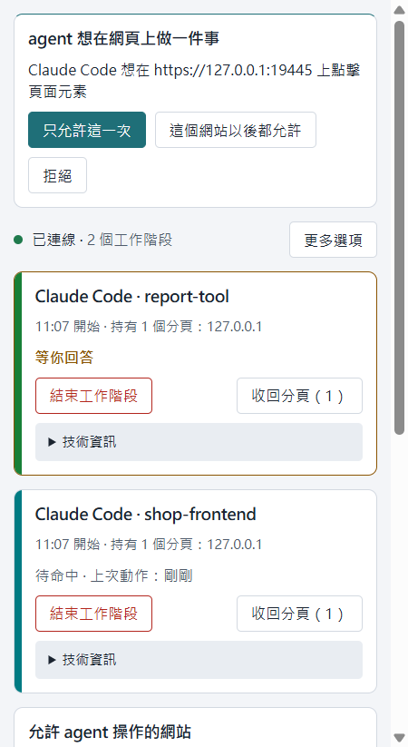

# 更新紀錄

每一版 Hallpass 改了什麼,新的在上面。英文完整版見 [CHANGELOG.md](CHANGELOG.md);安裝包在 [releases](https://github.com/norton77930/hallpass/releases)。
升級方式每一版都一樣(除非該節另有說明):重新安裝主機(zip 裡的 `install.ps1`,或從原始碼 `npm run agent-host:install`),再到 `chrome://extensions` 重新載入擴充功能。

## 0.15.2 — 2026-10-24

- **Hermes 不會拿到「已儲存的登入資料」工具**:0.15.0、0.15.1 用了 Hermes 不認得的名稱去關它,工具其實還在 Hermes 的查找清單裡。現在兩種模式都真的關掉了;Hermes 自己的瀏覽器工具一併關閉(它改用 Hallpass 的瀏覽器工具)。
- **側欄會說它在等什麼**:agent 啟動時顯示「正在啟動 <agent>…(第一次啟動可能要 30–60 秒)」;送出訊息後顯示已等待的秒數,超過 30 秒提醒確認模型伺服器連得上(網路或 VPN)。以前可能好幾分鐘什麼都沒顯示。
- **缺瀏覽器工具會說明**:Hermes 少了選用的 MCP 元件,或使用 DeepSeek(不支援 MCP)時,側欄會說 agent 無法使用瀏覽器,以及怎麼處理:安裝 Hermes 的 MCP 元件,或改附截圖、目前分頁。
- **Hermes、DeepSeek 也能「附上目前分頁」**:不接受頁面內容的 agent,分頁標題和文字會存成對話資料夾裡的 `.txt` 檔,以路徑告訴 agent。
- **瀏覽器看不到金鑰時會說明**:agent 啟動失敗,而它設定裡指定的金鑰變數在你的使用者環境有、Chrome 傳下去的環境卻沒有(Chrome 比你設定變數更早啟動),側欄會請你完全結束 Chrome(含背景執行)再重開。Hallpass 只看名稱,從不讀取值。
- **可查看 agent 自己的輸出**:對話詳細資料可顯示 agent 最後幾行輸出,環境變數的值會被移除;只留在記憶體,對話結束就丟掉。
- **agent 安裝更穩**:中斷的安裝在原程序結束後會接手完成;被其他程式占用的檔案不再被當成安裝損壞。
## 0.15.1 — 2026-10-23

- **DeepSeek 第一次下載快很多**:Hallpass 下載的 agent(DeepSeek,以及 Claude、Codex 的配接器)現在就在下載的位置使用,不再事後搬到定位。
  在有即時防毒掃描的電腦上,光是那次搬移 DeepSeek 就要約 41 分鐘;改版後同一台電腦第一次下載 DeepSeek 只花 5.5 分鐘。舊版裝好的不用重新下載。
- **相依套件安全更新**:MCP SDK 1.32.0(含 hono 4.13.11、ip-address 10.7.4),建置工具 vite 8.2.4、vitest 5.0.3。DeepSeek 自己固定的套件等它下一版再一起更新。
- **DeepSeek 的模式維持固定**:就算在第一次啟動途中收到換模式的要求也一樣;啟動途中選同一個模式現在會被接受。

## 0.15.0 — 2026-10-23

- **訊息可以附東西**:輸入框的「+」可加入圖片(選取、貼上或拖放,太大會自動縮小)、其他檔案(複製進對話資料夾並告訴 agent,
  上限 25 MB)、目前分頁的截圖,或把目前分頁當文字附上(PDF 分頁會存成檔案)。agent 不能收的項目會停用並說明原因;附件以 chip 顯示在文字上方,留在原本的對話。
- **新增 Hermes Agent**(測試版本 0.22.2):Hallpass 不替你安裝,只會找你自己裝好的 Hermes,找不到時說明怎麼裝測試過的版本。
  「變更前先問」模式下 Hermes 每次修改前都會問,而且沒有指令工具;切到「agent 自行審查」會就地重啟 Hermes 並保留對話。執行指令需要 Git for Windows。
- **新增 DeepSeek Harness**(官方 `@deepseek-ai/dsh` 預覽版 0.2.1-rc.2):第一次使用時由 Hallpass 下載,約需 30 分鐘,面板會說明並提供取消;
  「變更前先問」為唯讀,「agent 自行審查」為工作資料夾可寫,絕不使用完全存取;使用量回報已關閉。對話開始後模式就固定(要換請開新對話);
  開啟舊的 DeepSeek 對話時會說明先前的訊息無法顯示;DeepSeek 沒有描述的動作,卡片只提供「拒絕」。
- **金鑰留在 agent 那邊**:Hallpass 不會詢問、讀取或儲存任何模型金鑰;Hermes 與 DeepSeek 用各自的設定,缺少時面板會說明在哪裡設定。
- **新對話一律從「變更前先問」開始**,除非你在送出第一則訊息前為它另選模式。
- 已知限制:DeepSeek Harness 是預覽版;模式切換後,接續的 Hermes 對話可能仍以為自己受先前的工具限制。

## 0.14.0 — 2026-10-21

- **對話介面重新設計**:輸入框在每個畫面都固定在最下方，agent、資料夾、模式都是框內的 chip,選單往上彈出;
  標題列精簡成對話清單與開新對話兩個按鈕。新配色(A),支援亮色與暗色。
- **更好讀**:你的訊息靠右成泡泡，agent 的回覆直接排開;步驟收成「N 個步驟」一行(失敗的會標出);
  回答過的權限卡縮成一行記錄你怎麼回答;往上捲時出現「跳到最新」。
- **從清單點舊對話會立刻切過去**,先顯示啟動中，再顯示歷史或它自己的「無法繼續」頁;沒送出的草稿留在原本的對話。
- **訊息用你的語言**:輔助程式的拒絕原因與提示會用面板的語言顯示;agent 自己寫的內容照原文。
- **連線與網站整理過**:分區小標題、網站一行一個並以 chip 顯示模式、每行有「⋯」選單、上傳資料夾名稱在上路徑在下、
  網站不顯示 `https://`;連不到輔助程式時有清楚的說明與修復按鈕。

## 0.13.1 — 2026-10-20

- **關閉瀏覽器時，側欄 agent 立即結束**:broker 會直接看瀏覽器主程序，瀏覽器一關就結束所有側欄 agent(0.13.0 約要 16 秒)。
  若只是主機連線被重啟，broker 最多等 35 秒讓瀏覽器重新連上(原本 15 秒)。
- **第一次使用直接進入對話**:一次性下載 connector 後，會在你選的資料夾直接開始你要的對話，不再回到 agent 清單。
- **重新載入擴充功能後，不再殘留「在另一個瀏覽器使用中」標籤。**
- **同一資料夾只算一筆**:結尾有沒有 `\` 都視為同一資料夾，既有重複會合併。
- **強化**:撤回側欄同意後，不會再有任何瞬間把瀏覽器連線交給正在啟動的 agent;已撤回的連線在 broker 重新連上時不會被再次接受;broker 紀錄檔以獨占方式建立。

## 0.13.0 — 2026-10-20

- **側欄多了「對話」分頁**:側欄分成 *對話* 與 *連線與網站*(原本的內容都在後者),外部 agent 的同意卡片固定在兩者上方。
  對話用的是你已安裝並登入的 Claude Code / Codex,第一次使用經你同意後下載一個釘住版本的小型 connector
  (依安裝包內的 lockfile 以 `npm ci` 下載、比對雜湊、不執行安裝腳本)。詳見 README「在側欄直接和你的 agent 對話」。
- **預設嚴格**:每段對話從 agent 的詢問模式開始，改檔與會改變東西的指令都會出現「只允許這一次 / 拒絕 / 這段對話都允許」;
  單一段對話可切到 agent 自己的自動審查。永遠不提供全部放行的模式。Codex 的嚴格模式以唯讀執行，在自己的資料夾內改檔也會先問。agent 回報的每個動作都列在對話裡。
- **用瀏覽器的規則不變**:一次同意後，側欄 agent 和外部 agent 走同樣的網站模式與同意卡片，網站清單標出最後由哪一邊改動；
  收回同意會立刻切斷所有正在跑的側欄 agent。
- **只記清單、不存內容**:Hallpass 只保存最近對話的索引(標題、agent、資料夾、模式、最後使用;30 天內最新 50 筆),
  打開舊對話時由 agent 自己的紀錄重播。每段對話一個資料夾：自己的暫存資料夾或你加入的專案資料夾。
- **生命週期**:主機啟動的 broker 管理 agent:關側欄不會停，關瀏覽器全部結束(Windows job object,不留孤兒行程),
  閒置 10 分鐘停下、下次傳訊息再回來，最多同時 3 個。
- **升級**:照常重新安裝主機。安裝包新增 `host\broker.js`、精簡的 `koffi` 與 `host\agents\`;
  `uninstall.ps1` 會刪對話相關檔案、保留 `scratch\`。37 個瀏覽器工具不變。

## 0.12.5 — 2026-10-18

- **頁面忙到來不及回應時，回答更準**:還沒送出任何輸入、光是連上頁面(檢查或注入頁面內的執行環境)就逾時，現在回 `page-not-responding` 並提示可以重試；以前會以 `content.probe` / `content.injection` 失敗，或說輸入「可能已經生效」。已經送出輸入之後才逾時，仍說可能已經生效。
- **動作在自己被取消之後才到頁面，回 `cancelled`**:以前回「頁面已過期」;其他晚到的請求照舊。
- **`viewport` 重設回報的頁面尺寸，一律和截圖同一套基準**:以前量得到頁面時會少一條捲軸的寬度;重設時也不再額外量測頁面。

## 0.12.4 — 2026-10-18

- **告訴 agent 沒完成的頁面內動作，不會事後才生效**:`scroll`、`form_input` 等頁面內動作超過該次呼叫的時間、agent 已收到 `page-not-responding` 後，worker 會停掉這次呼叫剩下的步驟；頁面若在那之後才收到請求，會在動到任何東西前拒絕。頁面已經開始執行的動作無法中途停下，提示仍會說「可能已經生效」。
- **單次頁面往返超過 10 秒，回 `page-not-responding`**:以前會以 `content.execution` 失敗，現在和整體時間上限的回答與提示一致。
- **設定了 `viewport` 尺寸、頁面又有縮放時，座標仍然準**:這時頁面實際排版寬度是設定寬度除以縮放比例(125% 時 500 寬等於 400 頁面像素)。頁面尺寸與座標換算現在照這個算，截圖仍拍到整個頁面(捲動後也一樣);設定尺寸期間改變縮放，會被 `viewport-changed` 擋下。
- **讀不到縮放比例時，不再當成 100%**:截圖不回報頁面尺寸、座標不換算，避免用錯的尺寸換算；設定了 `viewport` 尺寸的分頁則拒絕截圖。
- **`viewport` 重設回報的頁面尺寸與截圖同一套基準**(縮放過的頁面以前回報未縮放的尺寸)。

## 0.12.3 — 2026-10-18

- **整頁截圖改成 JPEG**:不帶 `region` 的 `screenshot` 與 `computer` 的截圖改回傳品質 0.75 的 `image/jpeg`,像素尺寸和 0.12.2 一樣。還是超過單次回應上限時，每次降 0.05 重壓，最低到 0.10,仍太大才拒絕；`computer` 的截圖現在也會像 `screenshot` 一樣回「請用 scale ≤ … 重試」,不再整個呼叫失敗。區域截圖維持 PNG、保留螢幕實際像素。
- **`upload_image` 的預設檔名跟著圖的格式**:沒給 `filename` 時，整頁截圖叫 `screenshot.jpg`、區域截圖叫 `screenshot.png`;有給就照給的。
- **頁面寬度變了，座標動作會被擋下**:上一張整頁截圖之後，若頁面寬度改變(調整或貼齊視窗、縮放頁面),用座標的動作(`computer`、指標工具的座標形式、`drag`、`scroll`、`upload_image` 的放下位置、截圖的 `region`)在動手前就回 `viewport-changed`,請 agent 重新截圖。只有高度改變(例如出現提示列)不會擋。
- **頁面縮放算進頁面尺寸**:截圖回報的頁面尺寸與座標換算現在考慮分頁的縮放比例；0.12.2 在縮放過的頁面上是用未縮放的尺寸換算。
- GIF 錄製的備援畫格不變(無損，由錄製器自己編碼)。

## 0.12.2 — 2026-10-17

- **從截圖上量的座標，點下去就是那裡**:以前整頁截圖是螢幕實際像素(125% 縮放時，1187 寬的頁面截出 1484 寬),agent 給的座標卻被當成頁面(CSS)像素，照截圖點會偏掉，常點到旁邊的元素或超出頁面。現在整頁截圖以頁面尺寸回傳，最長邊不超過 1568、總面積約 115 萬像素以內；之後 agent 給的座標(`computer`、`click` 等指標工具的座標形式、`drag`、`scroll`、`upload_image` 的放下位置、截圖的 `region`)都以這張圖的像素來讀，再換回頁面座標。
- **還沒截過整頁圖時，座標仍是頁面像素**;調整視窗大小或設定/重設 `viewport` 之後，換算會取消，直到下一張整頁截圖。
- **區域截圖保留原本的清晰度**:`region` 仍以螢幕實際像素裁切。

## 0.12.1 — 2026-10-12

- **打進目前焦點的按鍵也會先確認網站**:沒有指定目標的 `type`、`key`,以及沒有座標的 `computer` 按鍵或打字，在送出第一個按鍵前會確認分頁的網站，和點擊一樣。分頁已經換到別的網站(或正開始載入別的網站)時，一個按鍵都不送，並告訴 agent。
- **頁面內的捲動與填表也在時間內回答**:頁面一直卡住時,`scroll` 或 `form_input` 會在這次呼叫的 25 秒預算內回 `page-not-responding`,不會拖過主機的等待時間變成沒有回應。
- **「頁面沒回應」的提示不再寫固定秒數**:改成說頁面沒有及時回應這個輸入，不管是哪一個期限結束等待都正確。

## 0.12.0 — 2026-10-11

- **按下與截圖前再確認一次網站**:點擊、滑過、捲動、拖曳在游標滑到定位之後、按下之前，會再確認一次分頁的網站；截圖在擷取前也會確認。分頁已經換到別的網站(或正開始載入別的網站)時，什麼都不送、不截，並告訴 agent;下一次對那個分頁的呼叫，如果那個網站需要你決定，會再問你。
- **把分頁拖出 agent 的群組，它就回到你手上**:工作階段立刻不再持有它;`tabs_context` / `tabs_close` 會告訴 agent 哪些分頁被收回、哪個群組已經不在，以及關掉群組不會關到群組外的分頁。
- **每次呼叫一份時間預算**:頁面一直卡住的點擊或按鍵，會在 25 秒內回 `page-not-responding`,不會拖過主機的等待時間變成沒有回應。`browser_batch` 每一步各有一份預算。
- **小修正**:背景分頁的截圖會等一次繪製，不再拍到舊畫面；主機收回的配對卡片，即使瀏覽器儲存很慢也會立刻消失；當作下拉選單用的輸入框，現在對得上「search box」這類描述;`tabs_context` 的提示會送到 agent。

## 0.11.2 — 2026-10-05

- **選瀏覽器時側欄沒開，會直接告訴你**:`request_browser_choice` 等待中、某個瀏覽器的側欄沒打開時,agent 的進度文字會請你在要用的瀏覽器打開側欄並在那裡確認；沒人回答而結束時也是這一句。不再借用寫著 Chrome 的同意卡句子。
- **`uninstall.ps1` 會還原每一個瀏覽器**:把備份的主機放回去時，除了 Chrome 與 Chromium,也會替 Edge 與 Brave 重新登記。

## 0.11.1 — 2026-10-04

- **瀏覽器找不到 `node` 時，主機也能啟動**：從終端機開的瀏覽器，有時交給主機的環境變數 `PATH` 找不到 Node.js,
  主機會直接結束，側欄只顯示沒有 agent 連線。現在主機的啟動器會用完整路徑執行安裝它的那個 Node.js,
  只有那個檔案不見時才改用 `PATH` 上的 `node`。因此在重新安裝主機之前，主機會一直用安裝當時的 Node.js。
- **Microsoft Edge:`tabs_create` 之後馬上 `navigate` 不再逾時**:新分頁還沒開始載入自己的頁面時，Edge 會丟掉第二次導覽；
  現在 `navigate` 會先等新分頁載入第一個頁面(最多五秒，算在原本的時限內)。等待期間分頁被關掉，會回報分頁已不存在。
- **撤回的配對請求，卡片會從側欄消失**,即使瀏覽器的擴充功能儲存區回應很慢也一樣。

升級：重新安裝主機(新的啟動器是安裝時寫入的),再重新載入擴充功能。

## 0.11.0 — 2026-10-03

- **同時開好幾個瀏覽器，由你決定 agent 用哪一個**：每個裝了 Hallpass 的瀏覽器(或 profile)現在都會同時服務，
  不再有瀏覽器要等另一個關掉。只開一個時一切照舊。開了好幾個時,agent 第一次用瀏覽器工具會被擋下，直到你說要用哪一個：
  新增三個工具(工具數變成 37 個),`list_browsers` 列出瀏覽器、`select_browser` 選你指定的那個、
  `request_browser_choice` 讓每個側欄都跳出「要讓這個瀏覽器給 … 用嗎?」,你在哪個瀏覽器按確認就用哪個(兩分鐘沒回應就結束)。
  Hallpass 不會替你挑。選擇會記住，那個瀏覽器有開就用它；它沒開時 agent 會被告知並重新問你，不會自己換到別的瀏覽器。
  配對和每個網站的同意都各自留在原本的瀏覽器，在一個瀏覽器允許的事，不會讓另一個瀏覽器也允許。
  側欄會顯示這個瀏覽器的名稱(可以在這裡改名),以及另外有幾個瀏覽器連線。
  升級時請重新安裝主機，並在**每一個**瀏覽器重新載入擴充功能。還沒重新載入擴充功能的瀏覽器會用通用名稱「Browser」列出，
  也無法顯示「在瀏覽器裡選」的卡片；還在用升級前那個主機的瀏覽器會列為「Browser (older Hallpass)」,直到它重新啟動。
  兩種情況都還能用，各自當成一個瀏覽器。0.10.0 的「有別的瀏覽器在服務」畫面也一併移除。
- **其他**:點擊或拖曳的位置找不到東西時，會提醒 agent 先截圖或改用 ref;網站計畫卡片上取消的勾選，被別的問題擠掉再回來時會保留；
  國際化網域會以你的文字顯示，並在旁邊附上 ASCII 名稱；工作階段卡片只對核准它的 agent 顯示網站計畫。

## 0.10.0 — 2026-10-02

- **agent 可以事先一次說好要用哪些網站**：新工具 `propose_sites` 讓 agent 列出這個任務需要的網站並說明用途（工具數變成 34 個）。
  側欄會出現一張卡片列出所有網站和用途，你可以取消勾選不想給的網站；卡片也會提醒你，網頁可能會誘使 agent 要求更多權限，
  只核准這個任務本來就該用到的網站。你按下「核准勾選的網站」之前什麼都不算數，agent 傳什麼參數都無法替你核准。
  核准後，這一個工作階段在這些網站（完全相同的協定、主機與連接埠）上點擊、輸入、填表、捲動，不必每個動作都問。
  工作階段結束、你解除配對這個 agent、或瀏覽器關閉時就失效；它不會寫進你記住的網站清單，
  工作階段卡片上看得到它，也可以按「撤回網站計畫」立刻結束。執行頁面 JavaScript、上傳檔案、
  頁面把分頁帶到你沒決定過的網站，照樣會問；清單以外的網站和其他工作階段，行為完全不變。
  需要 0.10.0 的擴充功能：舊版擴充功能收到時會回答「請重新載入擴充功能」，不會核准任何東西。
- **修正：兩個裝了 Hallpass 的瀏覽器不再互相搶連線**：同一台電腦上兩個瀏覽器（例如 Chrome 和 Edge）都裝了 Hallpass 時，
  以前會每隔幾秒互搶連線，兩邊的 agent 呼叫都逾時。現在先連上的瀏覽器會繼續服務你的 agent，
  另一個的側欄會說有別的瀏覽器在服務，等你關掉第一個時自動接手。兩個瀏覽器都需要這一版的擴充功能。

## 0.9.0 — 2026-09-27

- **側欄一眼看得懂**：狀態列只寫連線狀態和有幾個工作階段（「● 已連線 · 2 個工作階段」），不再寫某個 agent 的名字。
  配對過的 agent 移到「更多選項」裡，每一個都有自己的「解除配對」。側欄裡也不再重複一次產品名稱當標題。
- **工作階段卡片寫出是哪個專案**：卡片標題是 agent 名稱加上專案資料夾（例如「Claude Code · shop-frontend」），
  第二行寫開始時間和持有的分頁；內部的工作階段 ID 收進「技術資訊」。卡片只會是三種狀態之一：
  「正在操作」（有呼叫在進行）、「等你回答」（它有問題在等你，卡片會標出來）、「待命中 · 上次動作：12 分鐘前」。
  按鈕只出現做得到的：「結束工作階段」一直都在、位置不變；「中斷這一步」只在正在操作時出現；
  「收回分頁（N）」只在它持有分頁時出現。
- **網站列只說一次**：「不問就直接做」這個模式改成在下拉選單加上警示色的邊框，不再多一個標籤；
  診斷授權的勾選框直接寫出允許什麼：「允許讀取 console 與網路紀錄」；撤銷按鈕只寫「撤銷」（螢幕閱讀器仍會唸出網站）。
- **分頁列分得出是哪個工作階段**：每個工作階段的分頁群組都叫 `Hallpass`，正在操作時前面加 `⌛`，
  等你回答時加 `🔔`；群組用這個工作階段自己的顏色，和它在側欄卡片左側的顏色條一樣。
  重新啟動後留下來的群組（0.8.0 以前的 `Agent`，或有沒有前綴的 `Hallpass`）會在擴充功能啟動時清掉。
- **會跳出對話框的按鍵，答案就是那個對話框**：和會跳對話框的點擊一樣，不再以 `page-not-responding` 結束。

**從 0.8.0 升級**：請重新安裝本機主機（`npm run agent-host:install`，或安裝包裡的 `install.ps1`），
再到 `chrome://extensions` 重新載入擴充功能，先後順序都可以。專案名稱是新主機送來的：
主機還是 0.8.0 時，卡片會寫開始時間而不是專案名稱（例如「Claude Code · 14:02 開始」）；
0.9.0 主機配 0.8.0 擴充功能，就照 0.8.0 的方式運作。

## 0.8.0 — 2026-09-26

- **按下去做了什麼,答案會說**:點擊(以及其他按壓動作,單獨呼叫或放在 batch 裡都一樣)的答案,
  會寫出觀察時間內接著發生了什麼:這個分頁換到新的頁面(附新網址)、開了新分頁(寫出分頁 id 與網址;
  這些分頁不屬於這個 session,要操作請用 `tabs_claim` 接手)、開始了下載(寫法和 `downloads_context` 相同),
  或什麼都沒發生。按的是連結卻什麼都沒發生時,答案會直說,並建議 agent 先讀頁面或等一下,再判斷是不是真的沒反應。
- **頁面沒回應不再被說成 stale**:頁面 10 秒沒回應時,呼叫會以 `page-not-responding` 結束,
  提示說頁面還開著。如果還沒送出任何東西,可以直接再試一次;如果是點擊或打字已經送到頁面後才沒回應,
  提示會說這個輸入可能已經生效,請先看看頁面再決定要不要重送。`stale` 只留給「頁面已經被換掉」和「分頁已經不在」這兩種情況。
- **每一個下載完成都只回報一次**:`wait` 等下載完成時,這個 session 的每一個下載(完成、失敗或取消)
  都會各回報一次,先結束的先回報;在開始等之前就已經結束的也算。
- **batch 裡也能上傳**:`file_upload` 和 `upload_image` 可以當 `browser_batch` 的步驟,檢查和單獨呼叫完全一樣。
  需要問你資料夾的,會在 batch 開始跑**之前**依步驟順序一次問一個;任何一個答「拒絕」,整個 batch 都不會執行。
  同一個 batch 裡拍的截圖不能在同一個 batch 上傳,要在下一次呼叫再上傳。
- **沒人在等的配對卡片會消失**:配對卡片背後的 agent 不再等了(等待時間到了,或它斷線了),
  卡片會從側欄移除,「!」徽章也會清掉。

**升級**:請重新安裝本機主機(`npm run agent-host:install`,或安裝包裡的 `install.ps1`),
再到 `chrome://extensions` 重新載入擴充功能,先後順序都可以。升級途中主機和擴充功能的版本可以不同:
新主機要等擴充功能表示看得懂,才會在配對請求上附上新的編號,所以 0.8.0 主機配 0.7.0 擴充功能(或反過來)
都會照 0.7.0 的方式運作。

## 0.7.0

- **配對只在 agent 真的要動手時才問**:agent 連上來不再跳卡片,要等它第一次呼叫工具才會出現。
  同一個 agent 有好幾條連線在等時,卡片會寫出有幾條,新加入的那條會標出來。
- **按「忽略」會馬上回覆 agent**:忽略配對卡片,等著的那次呼叫立刻以「拒絕這一次」結束,agent 會被告知不要重試,
  下一次呼叫就會重新問你。「解除配對」仍然會拒絕這個 session 之後的每一次呼叫,答案裡現在會提醒 agent 用 `/mcp` 重新連線。
- **以你眼前的視窗為準**:「!」徽章和兩分鐘的等待時間,跟著你目前所在的視窗走;
  別的視窗開著側欄,不會再把卡片藏起來或把等待縮短。
- **紅色邊框該出現就出現**:agent 操作中的分頁重新載入或換頁(包括按 F5)後紅框還在;
  擴充功能重新載入之前就開著的分頁也一樣。

**升級**:請重新安裝本機主機(`npm run agent-host:install`,或安裝包裡的 `install.ps1`)。
連線時不跳卡片、「忽略」只拒絕一次,這兩件事在主機裡。已安裝的 0.6.0 主機在你按「忽略」之後,
仍會像以前一樣拒絕這個 session 之後的每一次呼叫。

## 0.6.0 — 2026-09-23

- **中斷**:session 卡片上「停止」旁邊多一個「中斷」。它只結束正在跑的那一步(一秒內,不管那一步在等什麼),
  其他都留著:配對、分頁與分頁群組、網站模式、正在錄的 GIF、已套用的模擬視窗大小。agent 會知道是你中斷的,
  也會知道剛才有沒有東西已經送進頁面,自己決定要不要再試一次。「停止」的意思不變:結束整個 session。
- **跳到別的網站會先問你**:agent 操作中的分頁離開原本的網站、到了你從來沒決定過的網站時(點擊後被轉址、
  登入服務、短網址),造成這件事的那一次呼叫會在答案裡說明,而**下一次**對那個分頁的呼叫會跳出卡片,
  同時寫出兩個網站:**繼續**(這次 session)、**一律允許**(記住這一組,以後不再問)、
  **拒絕**(只拒絕這一次;session 繼續,問題留給下一次呼叫)。要離開的呼叫不會被擋:換去別的網址、
  關掉分頁、把分頁還你,都直接放行。記住的組合會列在側欄,寫著上次使用時間,旁邊有**撤銷**。
- **上傳你資料夾以外的檔案也會先問你**:`file_upload` 以前直接拒絕,等於要先手動改 `config.json`。
  現在本機主機會把這次呼叫停住,側欄完整列出每個檔案、以及每個檔案所在的資料夾,讓你選:
  **這次就好**、**這個資料夾以後都可以**(加進清單)、或**拒絕**。磁碟機或網路分享的根目錄永遠不會被加進清單,
  那些檔案只會以「這次就好」放行,答案裡會說明原因。允許的資料夾也列在側欄,各自有**撤銷**;
  這份清單仍然只有你和這個檔案本身能改,agent 呼叫得到的工具沒有任何一個讀得到或加得了。
- 另外補上 013 留下的三件小事:`file_upload` 成功後也會像 `upload_image` 一樣在 session 卡片留一行;
  `upload_image` 的同意卡片會說清楚是哪一種放法(放進檔案欄位,還是拖放到頁面上的位置);
  `viewport` 現在也會錄進 GIF,頁面突然變窄的那一格終於說得出原因。

**升級**:請重新安裝本機主機(`npm run agent-host:install`,或安裝包裡的 `install.ps1`)。
0.5.0 的主機遇到允許資料夾以外的檔案時,只會回 `upload-not-allowed` 直接拒絕,不會問你。
擴充功能會先問主機做得到什麼,所以 0.6.0 的擴充功能配上舊主機,行為就跟 0.5.0 一樣。
