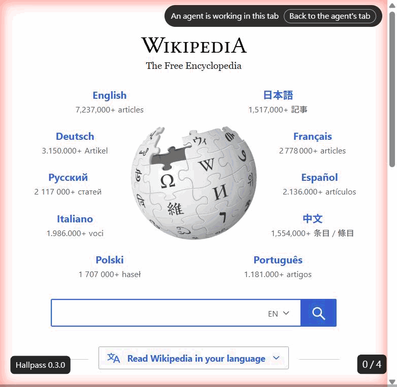

# Hallpass(瀏覽器代理橋接)

**讓 coding agent 操作你自己的 Chrome,每一步都由你放行。**

[English](README.md) · 繁體中文

Hallpass 是一個 Chrome 擴充功能加一個本機 MCP server。Claude Code、Codex CLI、Cursor、Claude Desktop
或任何 stdio MCP client 都能拿到 37 個瀏覽器工具,在你平常用的 Chrome、你的登入狀態下操作分頁。
每一個網站、每一個會改變頁面的動作,都受你在側欄做的決定管:只允許這一次、這個網站以後都允許、或拒絕。
你隨時可以停止 agent,把分頁拿回來。

> **平台**:Windows 11 + Google Chrome。Microsoft Edge 已於 2026-10-03 實機驗證;Brave 有註冊但未驗證(issue #2);macOS / Linux 尚未支援,見 issue #1。
> **授權**:Apache-2.0。

## 文件

- 英文 [README.md](README.md):安裝、第一次使用、同意模型、工具表、與 Claude in Chrome / chrome-devtools-mcp / playwright-mcp / BrowserMCP 的比較。
- [docs/zh-TW/operations-guide.md](docs/zh-TW/operations-guide.md):中文維護者手冊(從原始碼安裝、側欄、授權、疑難排解、跑驗收)。
- [docs/zh-TW/qa-guide.html](docs/zh-TW/qa-guide.html):中文 QA 試用指南(安裝包、CodeBuddy / Cursor 設定、含截圖)。
- [docs/design-notes.md](docs/design-notes.md):設計說明(英文):比較過哪些產品、對齊了哪些行為、為什麼。
- [specs/](specs/):每個功能的規格、計畫、任務與驗證紀錄(中英夾雜)。

## 三步開始

1. 從 [releases](../../releases/latest) 下載 `hallpass-<版本>.zip`,解壓縮到不會搬動的資料夾,執行 `install.ps1`。
2. `chrome://extensions` → 開發人員模式 → 載入未封裝項目 → 選 `extension\`。
3. 把 `install.ps1` 印出的 MCP server 定義貼進你的 AI 工具;Claude Code 一行:
   `claude mcp add hallpass --scope user -- node "<資料夾>\host\mcp-server.js"`。

從 0.2.0 升級請看英文 README 的 Upgrading 一節,或安裝包內 README 的 §2.1。

## 在側欄直接和你的 agent 對話(0.13.0 起)

除了讓終端機裡的 coding agent 用你的瀏覽器，側欄也能反過來用：**對話**分頁讓你直接和電腦上已安裝的
Claude Code 或 Codex 對話，談你正在看的頁面，不必切到終端機。另一個分頁 **工作階段** 顯示連線和進行中的工作階段，
外部 agent 的同意卡片固定在兩個分頁上方。

- **是你自己的 agent**:用的是你安裝並登入的 Claude Code / Codex(要先裝好,Hallpass 不替你安裝或登入),
  登入、設定、指示檔、MCP server、hook 都和終端機一樣，對話內容由 agent 自己保存。Hallpass 只記一份最近對話的清單
  (標題、agent、資料夾、模式、最後使用時間),方便日後接續。
- **第一次使用要你同意才下載**:需要下載的 agent 會在側欄的 agent 選單說明，並連到設定頁上它的卡片；卡片先說明要下載什麼，等你按下才開始：一個釘住版本的小型 *connector*
  (Claude Code 約 60 MB、Codex 約 20 MB),由 Node.js 附的 `npm` 依 Hallpass 安裝包裡的 lockfile 以 `npm ci` 下載，
  每個檔案都比對釘住的雜湊、不執行安裝腳本、不會自己更新，放在 `%LOCALAPPDATA%\hallpass\agents\`。
- **第一次也要你同意讓側欄的 agent 用這個瀏覽器**:之後不再每段對話配對；網站模式與同意卡片和外部 agent 完全相同、
  決定也共用，設定頁的網站清單會標出最後一次是側欄還是外部 agent 改的。可在設定頁 *瀏覽器工具* 用
  **讓側欄的 agent 使用瀏覽器工具** 收回。
- **每段對話一個資料夾**:預設在 `%LOCALAPPDATA%\hallpass\scratch\` 下自己的暫存資料夾，或用 Windows 資料夾對話框加入的專案資料夾；
  資料夾會顯示且不會變，要換地方就開新對話。Hallpass 不會刪暫存資料夾(裡面可能有 agent 寫給你的檔案)。
- **改東西前先問**:每段對話都從 agent 最嚴格的詢問模式開始；agent 要改檔案或執行會改變東西的指令前，對話裡會出現卡片：
  只允許這一次 / 拒絕 / 這段對話都允許。讀取不問。可以把單一段對話切到 agent 自己的自動審查，只有被它擋下的才問你；
  下一段對話又回到嚴格。**永遠不提供**不問就全部放行的模式。Codex 的嚴格模式由 Hallpass 維持唯讀，
  在對話資料夾內改檔也會先問；你自己的 Codex 規則已允許的指令仍會直接執行，側欄會說明。卡片沒回答，agent 就一直等，不會逾時變成放行。
- **生命週期**:關掉側欄不會停下 agent,重開會回到同一段對話；關掉瀏覽器會結束所有 agent,之後可以接續。
  閒置 10 分鐘的 agent 會停下，下次傳訊息再回來。最多同時 3 個。不會有 agent 行程比瀏覽器活得久。
- **隱私**:你的訊息和 agent 的回答會送到你那個 agent 的模型供應商，依該 agent 的條款處理;Hallpass 不保存(見 [PRIVACY.md](PRIVACY.md))。

## 設定頁(0.16.0 起)

常駐的決定都在設定頁，以完整分頁開啟：從側欄選單、agent 選單，或 `chrome://extensions` 的「擴充功能選項」進入。分成四區：

- **Agent**:每個側欄 agent 一張卡片，顯示狀態(可以使用、可以使用但有警告、需要下載、下載中、未安裝)、版本和檢查結果；
  需要的下載在這裡進行，有進度和取消；**測試** 做一次簡短的模型呼叫，說明 agent 能不能啟動、有沒有回應、拿不拿得到瀏覽器工具；
  **啟用** 開關和 **設為預設** 決定側欄提供哪些 agent。
- **網站與權限**:已配對的 agent(可取消配對)、每個網站的模式和診斷授權(可撤銷，並可復原)、上傳資料夾。
  工作階段卡片上的「管理這個網站的權限 ↗」會開到這一區並標出該網站。
- **瀏覽器工具**:哪些 agent 能用 Hallpass 的瀏覽器工具，以及讓側欄 agent 使用它們的開關。
- **連線與診斷**:輔助程式是否連上、版本、這個瀏覽器的名稱(可重新命名),以及按需查看 agent 最後幾行輸出(機密已移除)。

設定頁不會要求、顯示或儲存任何 API 金鑰，只會提到金鑰變數的名稱。

## 安全與隱私

- **留在你電腦上的**：Hallpass 沒有伺服器、沒有帳號、沒有遙測。MCP server、relay 和擴充功能之間只走
  loopback 與 Chrome native messaging，擴充功能本身不發任何網路請求。`relay.log` 只記穩定代碼，不記頁面內容。
- **會離開的**：工具回給 agent 的內容（頁面文字、表單值、截圖）會進到你的 coding agent，再送到它使用的模型供應商，
  就像 agent 讀你的檔案一樣。密碼、hidden、一次性驗證碼、信用卡欄位會被遮蔽，其他內容供應商都看得到。
- **Prompt injection**：網頁內容是不可信的輸入，可能試圖指揮讀到它的 agent。Hallpass 不偵測這件事，也不宣稱做得到；
  它給你的是決定點：在 **ask** 模式下，每個會改變頁面的動作都要等你放行，跳到你沒決定過的網站也會在下一次呼叫時問你。
  有帳號的網站請保持 **ask**，看到不預期的動作就按「結束工作階段」。
- **工作階段的網站計畫**：一個任務要跨好幾個網站時，agent 可以用 `propose_sites` 先列出要用的網站，
  你在側欄一次核准，也可以取消勾選其中幾個。之後只有這一個工作階段、只在這些網站上，頁面動作不必每次都問；
  工作階段結束、解除配對、瀏覽器關閉，或你在工作階段卡片上按「撤回網站計畫」時就失效。
  執行頁面 JavaScript、上傳檔案、跳到你沒決定過的網站照樣會問，清單以外的網站完全不受影響。
- **同時開好幾個瀏覽器**：每個裝了 Hallpass 的瀏覽器(或 profile)都會同時服務。只開一個時一切照舊；
  開了好幾個時,agent 第一次用瀏覽器工具會被擋下，先列出瀏覽器、問你要用哪一個，再用 `select_browser` 選定，
  或用 `request_browser_choice` 讓每個側欄都跳出「要讓這個瀏覽器給 … 用嗎?」,你在哪個瀏覽器按確認就用哪個。
  Hallpass 不會替你挑。選擇會記住；那個瀏覽器沒開時 agent 會被告知並重新問你，不會自己換到別的瀏覽器。
  配對與每個網站的同意都各自留在原本的瀏覽器，在一個瀏覽器允許的事，不會讓另一個瀏覽器也允許。
  側欄可以替這個瀏覽器取名(例如「公司 Edge」),也會顯示另外有幾個瀏覽器連線。

## 更新紀錄

每一版新增的功能見 [CHANGELOG.zh-TW.md](CHANGELOG.zh-TW.md)(英文完整版 [CHANGELOG.md](CHANGELOG.md))。
升級方式每一版都一樣：重新安裝主機(zip 裡的 `install.ps1`,或從原始碼 `npm run agent-host:install`),
再到 `chrome://extensions` 重新載入擴充功能，順序不拘。

## 貢獻

歡迎 issue 與 PR。[CONTRIBUTING.md](CONTRIBUTING.md) 說明建置、測試、「失敗兩次就停」的規則與 clean-room 邊界;
[SECURITY.md](SECURITY.md) 說明如何私下回報漏洞。
